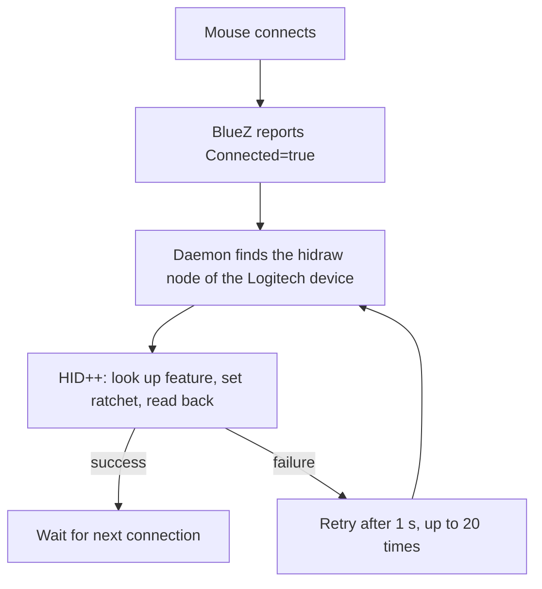

# mx-ratchetd

**Permanent ratchet mode for the Logitech MX Master 3 on Arch-based Linux distributions.**

A small daemon written in C for Arch Linux, with no extra dependencies.

> [!WARNING]
> **Disclaimer: this project was completely built by AI.**
> All code and documentation in this repository were written by Claude Sonnet 5.5 (Anthropic), because I do not have the skills to build this myself. I have tested the result on my own devices (see [Tested on](#tested-on)).
>
> If you do not want AI-generated code ("AI slop"), do not download this.
>
> The daemon runs as root, so please read the source code yourself before installing it.

> [!NOTE]
> **Arch Linux only.** I have only made and tested this for Arch Linux (and the Arch-based CachyOS and EndeavourOS), not for Linux in general. Other distributions are not tested, to avoid any misunderstanding.

## What does it do?

The Logitech MX Master 3 has a scroll wheel that can switch between two modes: *ratchet* (clicky, with tactile steps) and *free-spin* (spinning freely). On Windows and macOS, Logitech Options+ can set ratchet mode permanently. On Linux, Logitech Options doesn't exist. Existing programs such as [Solaar](https://github.com/pwr-Solaar/Solaar) and [OpenLogi](https://github.com/AprilNEA/OpenLogi) can do it, but they also change other settings. OpenLogi is what gave me the idea for this project.

`mx-ratchetd` does exactly **one** thing: it puts the wheel into ratchet mode for as long as the mouse is paired and connected over Bluetooth. All other mouse settings are left untouched.

> **In short.** A systemd service listens for Bluetooth connections. As soon as the mouse connects (or reconnects), the daemon sends a single HID++ command to the mouse, reads the setting back to verify it, and waits for the next connection.

## Tested on

- Logitech MX Master 3 and MX Master 3S, both over Bluetooth.
- CachyOS on a Dell Precision 7530 and Lenovo ThinkPad T15g Gen 1 laptop, and EndeavourOS on a self-built all-AMD desktop. All are Arch-based, and it kept working after a reboot.

The Logitech Unifying receiver and the Logi Bolt receiver that come with these mice have not been tested, and are not supported.

This has only been made for and tested on Arch-based distributions. Other distributions have not been tested.

## Installation

### Requirements

- An Arch-based distribution with systemd and BlueZ (`bluetooth.service`)
- `gcc` to build it
- the mouse must already be paired over Bluetooth

`gcc` is part of the `base-devel` group:

```bash
sudo pacman -S --needed base-devel
```

There are no extra runtime dependencies: the binary only uses libc and libsystemd, which are already present on Arch Linux.

### Steps

Put `install.sh` and `mx-ratchetd.c` in the same directory and run:

```bash
sudo ./install.sh              # builds, installs and starts the service
journalctl -fu mx-ratchetd     # follow the log
```

Does `./install.sh` give "permission denied"? Then the script is missing its execute permission (`chmod +x install.sh`), or the directory is on a partition mounted with `noexec`. In the first case, `sudo bash install.sh` always works.

After installation, two files are placed on the system:

```
/usr/local/bin/mx-ratchetd
/etc/systemd/system/mx-ratchetd.service
```

The installer automatically removes leftovers from an older Python/udev version, so you can run it over an existing installation. After changing the code, run `sudo ./install.sh` again: it rebuilds everything and restarts the service.

The `.c` file is only needed during installation. Afterwards, the service runs the binary in `/usr/local/bin`.

### Uninstalling

```bash
sudo ./install.sh uninstall
```

## Usage

Normally you do not need to do anything: the service runs in the background. For manual use or testing, there are a few options:

| Command | Effect |
|---|---|
| `mx-ratchetd` | Runs as a daemon and follows the connection |
| `mx-ratchetd --once` | Applies ratchet mode once and exits |
| `mx-ratchetd --status` | Only shows the current wheel mode |
| `mx-ratchetd --free` | Switches to free-spin (for testing) |
| `mx-ratchetd --device /dev/hidrawN` | Uses a specific hidraw node |

Manual commands require root privileges, for example `sudo mx-ratchetd --status`. Typical output:

```
mx-ratchetd: /dev/hidraw3: wheel mode = ratchet (auto-disengage = 255)
```

## How does it work?

### The setting itself (HID++ 2.0)

Logitech mice speak their own protocol, HID++ 2.0. On Linux, this goes through the mouse's device file `/dev/hidraw*`. The daemon does this in three steps:

1. **Look up the feature.** Through the built-in `IRoot` feature, the daemon asks for the index of feature `0x2111` (SmartShift Enhanced, MX Master 3 and 3S). If the mouse does not support it, it tries the older `0x2110`.
2. **Set the mode.** With `setRatchetControlMode` it sends three bytes (see below).
3. **Verify.** With `getRatchetControlMode` it reads the mode back. Only if the mode really is *ratchet* does the attempt count as successful.

Parameters of `setRatchetControlMode`:

| Byte | Value | Meaning |
|---|---|---|
| 1 | `2` | Wheel mode: 1 = free-spin, 2 = ratchet |
| 2 | `255` | Auto-disengage threshold: 255 = never switch to free-spin automatically |
| 3 | `0` | Leave the default value unchanged |

### Following the connection (BlueZ over D-Bus)

The mouse goes to sleep after a while and reconnects as soon as you move it. In doing so, the setting in the mouse may revert to its default. That is why the daemon listens for BlueZ's `PropertiesChanged` signal (`org.bluez.Device1`). When the `Connected` property changes to `true`, the daemon:

1. waits 0.5 seconds;
2. looks for all Logitech Bluetooth devices under `/sys/class/hidraw` (bus `0005`, vendor `046D`);
3. tries to apply the setting and read it back;
4. on failure, retries every second, up to **20 times**, because the hidraw device is sometimes ready slightly later than the connection itself.

This is entirely event-driven: between connections the daemon does nothing and uses no CPU and none of the mouse's battery. When the service starts, the same procedure runs once, in case the mouse is already connected.



## Files

| File | Purpose |
|---|---|
| `mx-ratchetd.c` | The daemon: HID++ communication and connection monitoring |
| `install.sh` | Builds the binary, installs the systemd service and cleans up old installations |

## Security

The service runs as root, because access to `/dev/hidraw*` requires it. To limit the possible damage, the systemd unit enables the following measures:

- `NoNewPrivileges=yes`: no extra privileges through child processes
- `ProtectSystem=strict` and `ProtectHome=yes`: the file system is read-only and home directories are invisible
- `PrivateTmp=yes`: private, isolated `/tmp`
- `MemoryDenyWriteExecute=yes`: no memory that is both writable and executable
- `RestrictAddressFamilies=AF_UNIX`: local sockets only, which D-Bus needs, and no network access

## Troubleshooting

**`no permission for /dev/hidrawN`**
The command is not running as root. Use `sudo` or the service.

**`no ratchet-capable mouse answered`**
The mouse was not connected or did not respond within 20 attempts. The daemon then waits for the next connection. Check with `bluetoothctl info` that the mouse is really connected.

**The wheel spins freely again after waking up, with no log line**
In that case BlueZ is not sending a connection signal. Check with `journalctl -u mx-ratchetd` whether a `Bluetooth device connected` line appears. If not, the logical extension is a lightweight periodic check of the wheel mode.

**The service does not start**
Check `systemctl status mx-ratchetd`. A failed D-Bus connection leads to an automatic restart after five seconds.

## Limitations

- Made and tested for Arch Linux only, not for Linux in general.
- Written for, and tested with, the MX Master 3 and 3S. Other mice with SmartShift (feature `0x2110`) may also work, but have not been tested.
- The SmartShift button on the mouse can switch the mode manually. At the next connection, the daemon sets it back to ratchet.
- Bluetooth only: the Logitech Unifying and Logi Bolt receivers that come with these mice are not tested and not supported.

## Licence

[MIT](LICENSE)
